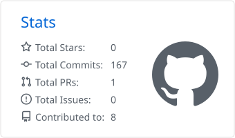
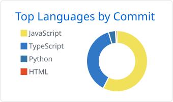

### `agvswira@github:~$ whoami`

```python
class AgusWira:
    def __init__(self):
        self.name = "Komang Agus Wira Adnyana"
        self.based_in = "Bali, Indonesia"
        self.education = "Informatics undergraduate @ Udayana University"
        self.cgpa = "3.89 / 4.00"
        self.role = "Aspiring AI/ML Engineer"
        self.os = ["CachyOS (Hyprland)", "Windows"]
        self.building = {
            "Reharsa": "AI hotel guests that tourism students practice speaking with",
            "Niagara": "AI agents that run order-to-cash for B2B distributors",
        }

    def status(self, online: bool) -> str:
        return "coding/vibing" if online else "lagi bobo"
```

### `agvswira@github:~$ ls ~/toolbox`

<p align="center"><code>languages/</code></p>
<p align="center">
  
  
  
  
  
  
</p>

<p align="center"><code>tools/</code></p>
<p align="center">
  
  
  
</p>

### `agvswira@github:~$ cat achievements.log`

```log
2026  3rd Place @ Bitsmikro Innovative Vibecode 2026
```

### `agvswira@github:~$ ./stats.sh`

<p align="center">
  <picture>
    <source media="(prefers-color-scheme: dark)" srcset="./profile-summary-card-output/github_dark/3-stats.svg" />
    
  </picture>
  <picture>
    <source media="(prefers-color-scheme: dark)" srcset="./profile-summary-card-output/github_dark/2-most-commit-language.svg" />
    
  </picture>
</p>

<p align="center">
  <picture>
    <source media="(prefers-color-scheme: dark)" srcset="https://streak-stats.demolab.com?user=agvswira&hide_border=true&background=00000000&ring=674fc9&fire=219ebc&currStreakLabel=219ebc&sideLabels=219ebc&currStreakNum=bde0fe&sideNums=bde0fe&dates=bde0fe&stroke=674fc9" />
    
  </picture>
</p>

### `agvswira@github:~$ ping discord`

<p align="center">
  <a href="https://discord.com/users/981150120571715604">
    
  </a>
</p>

### `agvswira@github:~$ exit`

<sub>if I haven't replied, check my status above. I'm probably asleep.</sub>
